<h3>AI engineer who ships. Hackathon winner. Obsessed with answers you can trust.</h3>

 

## 🚀 What I've built

<table>
<tr>
<td width="33%" valign="top">

#### 🪙 [GoldEye](https://github.com/ultramech79-art/PoonaWala)
Gold-loan pre-qualification from a phone. Reads hallmark, purity, audio, fraud signals and weight, then fuses them with live **IBJA** pricing into an instant valuation and loan eligibility.

🏆 *Won TenzorX 2026*

</td>
<td width="33%" valign="top">

#### 🛒 [Saarthi](https://github.com/Ultramech/E-Commerce-ChatBot)
A grounded **RAG + Text-to-SQL** shopping chatbot on an **Airflow** ETL pipeline with daily CI refreshes.

📈 **87.5%** faithfulness · **100%** routing accuracy

</td>
<td width="33%" valign="top">

#### ✈️ [AI Travel Planner](https://github.com/Ultramech/AI-Travel-Planner)
A **LangGraph** agent that plans trips with a human in the loop. Searches flights, trains, buses and cabs in parallel, then builds a weather-aware itinerary.

</td>
</tr>
</table>

Also: [CareCopilot](https://github.com/Ultramech/CareCopilot) · [QnA Chatbot Assistant](https://github.com/Ultramech/QnA-Chatbot-Assistant) · [Eye-Cursor](https://github.com/Ultramech/Eye-Cursor) · [Virtual-Piano](https://github.com/Ultramech/Virtual-Piano)

 

## 🏆 Wins

|   | Event | Outcome |
|:-:|:--|:--|
| 🥇 | **TenzorX National AI Hackathon 2026** | **1st nationally** out of 20,000+ teams and 4,500+ colleges, with a ₹4 Lakh prize |
| 🥇 | **Zelestra x AWS '25 Asian Hackathon** | **Winner.** TabNet solar-generation model with **R² = 0.9855** |
| 🎖️ | **Smart India Hackathon 2025** | **Finalist.** Top 5 of 1.5 lakh+ teams, with an AR tourism platform |

 

## 🧰 Tools

 

🎓 B.E. Computer Engineering at Thapar Institute · CGPA 9.00 · 350+ problems solved on LeetCode

